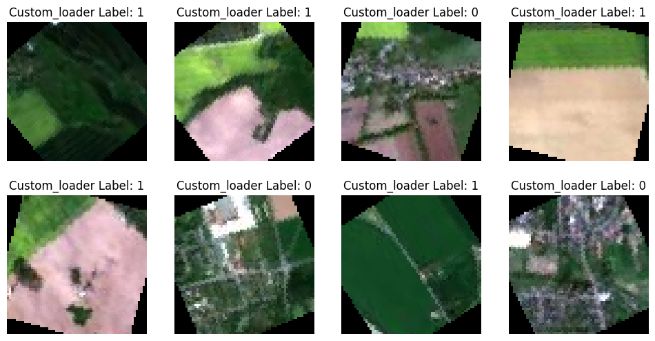
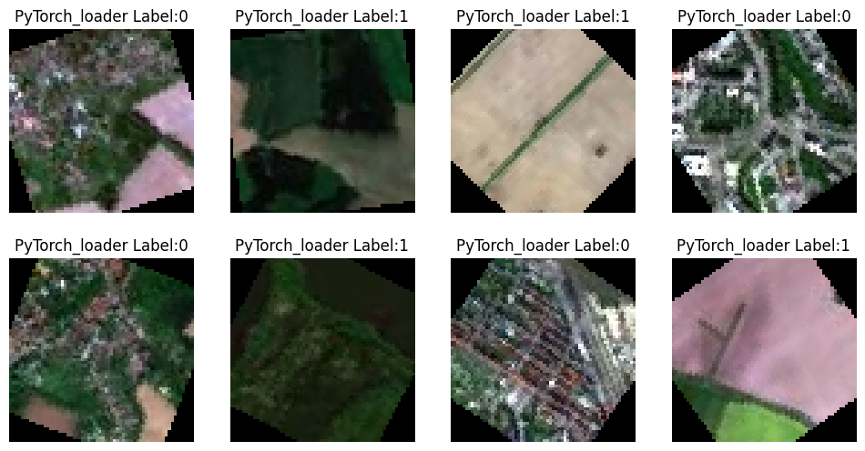

# Data Loading and Augmentation Using PyTorch

Building efficient image data pipelines in PyTorch: a **custom `Dataset` class** compared with the built-in **`torchvision.datasets.ImageFolder`**, both wrapped in a **`DataLoader`**, with data augmentation using `torchvision.transforms`.


---

## Table of Contents

1. [Overview](#overview)
2. [Dataset](#dataset)
3. [What the Notebook Does](#what-the-notebook-does)
4. [Results](#results)
5. [Custom Dataset vs ImageFolder](#custom-dataset-vs-imagefolder)
6. [Key Takeaways](#key-takeaways)
7. [Repository Structure](#repository-structure)
8. [Getting Started](#getting-started)
9. [Limitations and Future Work](#limitations-and-future-work)
10. [Tech Stack](#tech-stack)
11. [Acknowledgements](#acknowledgements)
12. [License](#license)

---

## Overview

PyTorch separates *what the data is* from *how it is iterated*:

- A **`Dataset`** defines how to get one sample at a time (loaded "just in time" from disk).
- A **`DataLoader`** wraps a dataset and handles batching, shuffling and parallel loading.

This project builds the same input pipeline in two ways and feeds both into a `DataLoader`:

1. **Custom `Dataset`**: a class inheriting from `torch.utils.data.Dataset` with `__init__`, `__len__` and `__getitem__`
2. **`ImageFolder`**: the built-in utility that infers labels from folder names

The task is binary classification of satellite images: **agricultural land vs non-agricultural land**.

## Dataset

Satellite image tiles, downloaded automatically in the notebook (about 20 MB):

```
https://cf-courses-data.s3.us.cloud-object-storage.appdomain.cloud/4Z1fwRR295-1O3PMQBH6Dg/images-dataSAT.tar
```

| Property | Value |
|---|---|
| Classes | 2 (`class_0_non_agri` = 0, `class_1_agri` = 1) |
| Images | 6,000 in total (3,000 per class) |
| Original image size | 64 x 64 pixels, RGB |

```
images_dataSAT/
├── class_0_non_agri/    # non-agricultural land (label 0)
└── class_1_agri/        # agricultural land (label 1)
```

## What the Notebook Does

| Step | Task | What was done |
|---|---|---|
| 1 | Setup | Installed NumPy, Matplotlib, pandas, PyTorch and torchvision, then downloaded and extracted the dataset |
| 2 | Custom `Dataset` | Defined `CustomBinaryClassDataset`: collects paths and labels (0 / 1), shuffles them, opens each image with Pillow in `__getitem__` and applies the transform |
| 3 | **Task 1** | Built `custom_transform`: resize to 64 x 64, `RandomHorizontalFlip(p=0.5)`, `RandomVerticalFlip(p=0.2)`, `RandomRotation(45)`, `ToTensor`, `Normalize` to [-1, 1] |
| 4 | **Task 2** | Created `imagefolder_dataset` with `ImageFolder(root=base_dir, transform=custom_transform)` |
| 5 | **Task 3** | Printed the class names and the class-to-index mapping |
| 6 | DataLoaders | Created `custom_loader` and `imagefolder_loader` (batch size 8, `shuffle=True`, `num_workers=2`) |
| 7 | **Task 4** | Pulled one batch from `imagefolder_loader` and printed the shapes |
| 8 | **Task 5** | Displayed one augmented batch from each loader with its labels |

## Results

| Check | Result |
|---|---|
| Classes found by `ImageFolder` | `['class_0_non_agri', 'class_1_agri']` |
| Class-to-index mapping | `{'class_0_non_agri': 0, 'class_1_agri': 1}` |
| Image batch shape (both loaders) | `torch.Size([8, 3, 64, 64])` |
| Label batch shape (both loaders) | `torch.Size([8])` |

The shape `[8, 3, 64, 64]` follows the PyTorch `[B, C, H, W]` convention: batch size, channels, height, width.

**One batch from the custom loader** (label 1 = agricultural, label 0 = non-agricultural). Rotation and flips are visible, and the black corners are the padding added by `RandomRotation`:



**One batch from the `ImageFolder` loader:**



## Custom Dataset vs ImageFolder

This is the qualitative comparison from the lab, not a measured benchmark.

| Feature | Custom `Dataset` | `ImageFolder` |
|---|---|---|
| Ease of use | Low: a class with three methods must be written | High: one line |
| Code complexity | High: paths, labels and loading logic are handled manually | Low: automatic discovery of paths and labels |
| Flexibility | Very high: any folder layout, labels from CSV/JSON, databases, custom logic | Moderate: needs the `root/class/image.ext` layout |
| Performance | Depends on how efficient `__getitem__` is; strong with `num_workers` | High out of the box |
| Best for | Complex or non-standard datasets | Most standard image classification tasks |

## Key Takeaways

- **Separation of concerns:** the `Dataset` gets one sample, and the `DataLoader` handles batching, shuffling and parallel loading.
- Sequential, path-based loading keeps memory use small, because only file paths are stored and each image is read when needed.
- **Augmentation transforms** (flips, rotations) run on PIL images and must come before `ToTensor()`. `Normalize` then rescales the tensor values to [-1, 1].
- Both approaches produce identical batch shapes, so the rest of a training pipeline does not care which one you choose.

## Repository Structure

```
pytorch-data-loading-augmentation/
├── notebooks/
│   └── Data_Loading_and_Augmentation_PyTorch.ipynb   # Full notebook with outputs
├── images/
│   ├── custom_loader_batch.png
│   └── imagefolder_loader_batch.png
├── .gitignore
├── LICENSE
├── README.md
└── requirements.txt
```

## Getting Started

### Prerequisites

- Python 3.9 or newer (the notebook was run on Python 3.12)
- An internet connection (the dataset downloads when the notebook runs)

### Installation

```bash
# 1. Clone the repository
git clone https://github.com/<your-username>/pytorch-data-loading-augmentation.git
cd pytorch-data-loading-augmentation

# 2. (Recommended) create a virtual environment
python -m venv .venv
source .venv/bin/activate        # Windows: .venv\Scripts\activate

# 3. Install dependencies
pip install -r requirements.txt
```

For a smaller CPU-only PyTorch build:

```bash
pip install torch torchvision --index-url https://download.pytorch.org/whl/cpu
```

### Run the notebook

```bash
jupyter notebook notebooks/Data_Loading_and_Augmentation_PyTorch.ipynb
```

Use **Kernel > Restart & Run All**. The dataset is extracted to `images_dataSAT/` (ignored by git).

> The notebook has three download cells that do the same job (`skillsnetwork.prepare` with an `httpx` fallback). Outside Skills Network Labs, if `skillsnetwork.prepare` fails, the fallback downloads the `.tar` file and extracts it. You can also download the archive from the URL above and extract it into the folder you run the notebook from.

## Limitations and Future Work

- The comparison is qualitative. Timing both loaders (and trying different `num_workers` values) would turn it into evidence.
- The custom dataset shuffles its file list in `__init__`, and the `DataLoader` shuffles again with `shuffle=True`. The second shuffle is the one that matters for training.
- The same random augmentation is used for every sample. In a real project, training data would get augmentation and validation data would get only resize, `ToTensor` and `Normalize`.
- There is no train/validation split, no random seed, and no model training. A natural next step is to split the data, train a small CNN with each loader and compare accuracy and epoch time.
- `num_workers=2` is set for all loaders. The best value depends on the machine.

## Tech Stack

- **Python**
- **PyTorch** and **torchvision**: `Dataset`, `DataLoader`, `ImageFolder`, `transforms`
- **NumPy**, **pandas** and **Matplotlib**: arrays, tables and visualization
- **Pillow (PIL)**: image loading
- **skillsnetwork**: dataset download helper
- **Jupyter Notebook**

## Acknowledgements

- Completed as part of the IBM AI Engineering course (IBM Skills Network). The lab structure, instructions and dataset are from that course and are © IBM Corporation.
- My work in the notebook: the augmentation pipeline (Task 1), the `ImageFolder` dataset and class mapping (Tasks 2 and 3), and the batch loading and visualization for both loaders (Tasks 4 and 5).

## License

My code is released under the [MIT License](LICENSE). The lab instructions and dataset remain © IBM Corporation.
